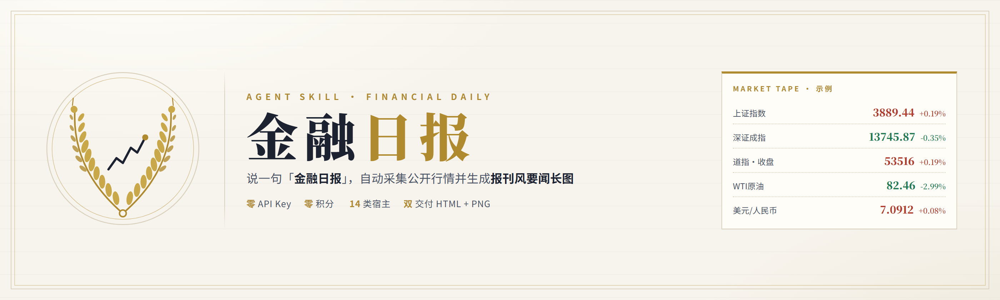
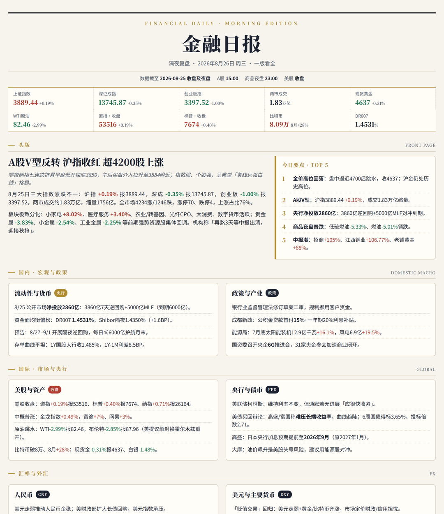
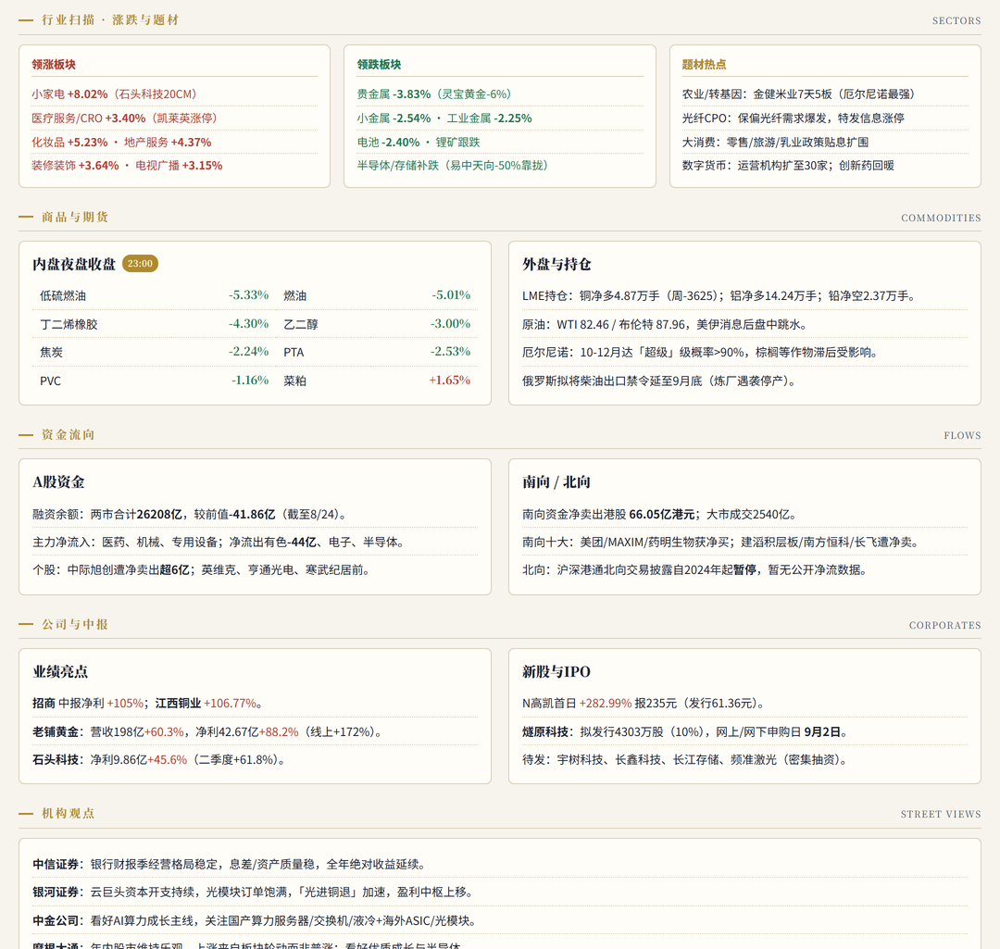
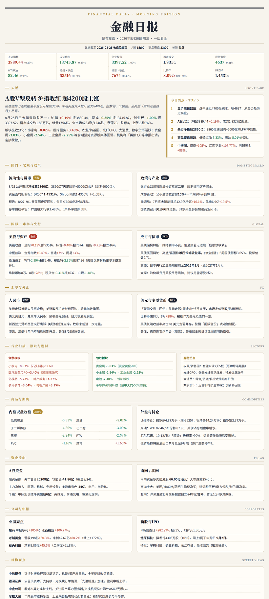

<div align="center">

<a href="https://github.com/EDboy-616/finance-daily-v5">
  
</a>

<br>


<br>

<a href="https://github.com/EDboy-616/finance-daily-v5/actions/workflows/verify.yml">
  
</a>
<a href="https://agentskills.io/specification">
  
</a>

<a href="LICENSE"></a>

<br><br>

说一句 <b>「金融日报」</b>，自动采集公开市场行情、检索权威媒体要闻，<br>
产出一份<b>报刊风（editorial）金融要闻日报</b>——网页必交，具备渲染能力时附高清长图。

</div>

<br>

> [!NOTE]
> **接手的 agent 请先读 [HANDOFF.md](HANDOFF.md)** —— 项目状态、架构约定、验证方法、待办事项都在那里。本 README 面向使用者。

---

## ✦ 产出预览

**报头与头版** —— 日期 / 时段 / 数据时点，价格速览条十卡一屏看完，主稿配 TOP 5 要点。



**板块细节** —— 行业扫描、商品期货、资金流向、公司中报、机构观点，全部按报纸栏目排布。



<details>
<summary><b>展开查看整版长图（点击）</b></summary>
<br>

</details>

一份日报固定包含 **13 个板块**（口径同 `SKILL.md` §3；报头含日期 / 时段 / 数据截至时点，不计入板块）：

| 板块 | 内容 | 板块 | 内容 |
|:--|:--|:--|:--|
| 价格速览条 | 10 个核心标的一屏看完 | 资金流向 | 两融、主力、南向 |
| 头版 FRONT PAGE | 主稿 + TOP 5 要点 | 公司与中报 | 业绩、IPO |
| 国内 · 宏观与政策 | 流动性、政策、产业 | 机构观点 | 券商与外资观点 |
| 国际 · 市场与央行 | 美股、美联储、债市 | 今日关注 | 事件、风险提示 |
| 汇率与外汇 | 人民币、美元、主要货币 | 数据说明 | 数据源披露（必填） |
| 行业扫描 | 领涨 / 领跌 / 题材 | 页脚 | 生成时间 |
| 商品与期货 | 内盘夜盘、外盘持仓 | | |

<sub>红涨绿跌（中国习惯）· 暖纸 <code>#f7f4ed</code> · 墨蓝 <code>#1c2230</code> · 金线 <code>#b08a2e</code> · 涨 <code>#b23b2e</code> · 跌 <code>#1e7a52</code></sub>

> 以上预览由 `assets/market_news_template.html` 以样例数据渲染，用于展示版面结构；真实产出会填入当日行情与新闻。

---

## ✦ 为什么是它

| 常见做法 | 代价 | 本技能 |
|:--|:--|:--|
| 接 Wind / 同花顺 连接器 | 账号、授权、按量计费 | **纯公开数据源**，脚本直连，零成本 |
| 让模型「凭记忆」写行情 | 数字编造，最危险的错 | 硬行情走脚本；取不到就**撤下或标「待核」** |
| 只给一段提示词 | 每次都要重新组织流程 | 完整 `SKILL.md`：取数 → 复核 → 排版 → 按能力交付（HTML 必交，PNG 可选） |
| 锁死在某一个 AI 工具 | 换宿主就废 | **15 个安装目标**（14 个可脚本安装 + 1 个纯对话手工粘贴）两套机制，一份源 |

**三条铁律**（任何降级都不放宽）

1. 每个数字要么来自脚本，要么有 **≥2 个权威源**一致；
2. 取不到 → **撤下或标「待核」，禁止编造、禁止取平均**；
3. 页面底部**必须**有「数据说明」，披露数据来源。

---

## ✦ 快速开始

```bash
git clone https://github.com/EDboy-616/finance-daily-v5.git
cd finance-daily-v5

python scripts/install.py --list          # 列出 15 个安装目标及落点（只读，不写文件）
python scripts/install.py --target claude # 装成当前项目的 .claude/skills/ 原生 skill
```

然后在对话里说 **「金融日报」** 即可。产出落在工作目录：

```
outputs/market_news_20261112.html   # 网页版
outputs/market_news_20261112.png    # 3x 高清长图
raw/market_20261112.json            # 结构化行情（每字段带 src/status，供复核）
```

想单独验证数据源连通性：

```bash
python scripts/fetch_public.py --date 2026-11-12 --out-dir ./raw
```

> [!TIP]
> **行情脚本零第三方依赖**，只用 Python 标准库；渲染 3x PNG 另需 `playwright` + `pillow` + chromium。
> 缺渲染依赖时按 `SKILL.md` §9 降级为**只交 HTML** 并注明，不会自动安装；只有你明确同意才执行：
> ```bash
> pip install playwright pillow && playwright install chromium
> ```

---

## ✦ 跨宿主：两种机制，各有取舍

`SKILL.md` 是唯一事实源（[Agent Skills 开放规范](https://agentskills.io/specification)）。装到别的宿主有**两条路**，本仓库两条都支持：

<table>
<tr><th width="18%">机制</th><th width="30%">怎么生效</th><th width="26%">优点</th><th width="26%">代价</th></tr>
<tr>
<td><b>注入式</b><br><code>inject</code></td>
<td>把 <code>adapters/&lt;宿主&gt;.md</code> 整篇写进该宿主常驻注入的上下文文件（<code>AGENTS.md</code> / <code>GEMINI.md</code> / <code>QWEN.md</code> / <code>CLAUDE.md</code> / <code>.cursor/rules/*.mdc</code>）</td>
<td><b>说「金融日报」就自动跑完整流程</b>——非 Claude 宿主没有关键词路由，正文不常驻就不会执行</td>
<td>每次会话固定吃 ~10k 字符上下文</td>
</tr>
<tr>
<td><b>原生 skills</b><br><code>skill</code></td>
<td>把整个 skill 目录复制进宿主的 skills 根（<code>~/.claude/skills/</code>、<code>~/.agents/skills/</code>、<code>~/.qwen/skills/</code> …）</td>
<td>正文按需加载、省上下文，可用宿主的 skill 管理/更新</td>
<td>多数宿主对原生 skill <b>只认显式调用</b>（Codex <code>$finance-daily-v5</code>、Gemini <code>/skill:finance-daily-v5</code>），触发词不会自动执行</td>
</tr>
</table>

> [!TIP]
> 想两者兼得：注入一份到项目 `AGENTS.md`（自动触发）+ 复制一份到宿主 skills 目录（显式调用与升级）。
> ```bash
> python scripts/install.py --target agents --mode inject   # 自动触发
> python scripts/install.py --target agents --mode skill    # 省上下文的显式调用
> python scripts/install.py --target all --global --dry-run # 先看全部落点，确认后去掉 --dry-run
> ```
>
> `--global` 只作用于原生 skills 目录；inject 目标一律相对项目目录解析。Cursor 没有全局 skills 路径，`--target all --global` 会对它回退成项目级 `.cursor/rules/finance-daily-v5.mdc` 注入。

### 各宿主落点与坑

| 宿主 | inject 目标 | 原生 skills（项目 / 全局） |
|:--|:--|:--|
| **Claude Code / claude.ai** | `CLAUDE.md` | `.claude/skills/`<br>`~/.claude/skills/` |
| **OpenAI Codex CLI** | `AGENTS.md` | `.agents/skills/`<br>`~/.agents/skills/` |
| **GitHub Copilot / VS Code** | `AGENTS.md` | `.github/skills/`<br>`~/.copilot/skills/`<br>亦读 `.claude/skills/`、`.agents/skills/` |
| **Gemini CLI** | `GEMINI.md` | `.gemini/skills/`<br>`~/.gemini/skills/` |
| **Qwen Code** | `QWEN.md` | `.qwen/skills/`<br>`~/.qwen/skills/` |
| **Cursor** | `.cursor/rules/finance-daily-v5.mdc` | `.cursor/skills/` |
| **OpenCode / TRAE / Kiro / Roo / Goose** | `AGENTS.md` | 各自的 `.<宿主>/skills/`<br>（OpenCode 全局为 `~/.config/opencode/skills/`，详见 `--list`） |
| **CodeBuddy** | `CODEBUDDY.md` | `.codebuddy/skills/`<br>`~/.codebuddy/skills/` |
| **Antigravity** | —（不支持 inject） | `.agent/skills/`<br>`~/.gemini/antigravity/skills/` |
| **GPTs / Kimi / DeepSeek / 豆包 / GLM（纯对话）** | 手工粘贴系统提示词 | — |

**装之前值得知道的六个坑**

- **Claude Code** 是唯一按 `description` 自动判定的宿主；但正文里不能写 `${CLAUDE_SKILL_DIR}` 这类宿主特性，否则会污染其他宿主。
- **Codex CLI** 没有 `.codex/skills/` 这个路径；`project_doc_max_bytes=32768`；全局与仓库的 `AGENTS.md` **只取第一个命中**。
- **Copilot / VS Code** 默认只吃 **8000 字符**（`chat.agent.customInstructionLimit`），而本适配文件约 10.9k（实测 10885 字符），需调大；调不动就用原生 skills 模式。
- **Qwen Code** 在 `QWEN.md` 与 `AGENTS.md` 并存时**优先 QWEN.md**，改完要 `/memory` 重载；**Gemini CLI** 的上下文文件不会自动执行动作，原生 skill 需 `/skill:` 显式调用。
- **Cursor** 只加载 `.mdc`；`alwaysApply:false` 时靠 `description` 命中，规则文件上限 1MB。
- **纯对话型（GPTs / Kimi / DeepSeek / 豆包 / GLM）装不了 skill**，只能贴系统提示词：最紧的豆包 4000 token 用 `adapters/system-prompt-slim.md`（约 2.6k 字符），能放长文的用 `adapters/system-prompt.md`。

### 能力降级（铁律不降）

| 档位 | 所需能力 | 产出 |
|:--|:--|:--|
| 完整版 | 命令 + 检索 + 打开网页 + Playwright | HTML + PNG 双交付 |
| 标准版 | 命令 + 检索 | HTML（新闻数字须 ≥2 源一致） |
| 行情版 | 仅命令 | 纯行情 HTML（新闻板块标注未采集） |
| 只读版 | 无（纯对话） | 用户本地跑 `fetch_public.py` 贴回 JSON，产出 HTML 文本 |

---

## ✦ 数据源与复核矩阵

| 指标 | 主源 | 复核源 |
|:--|:--|:--|
| A股三大指数 | 新浪 `hq.sinajs.cn` | 新闻通稿 |
| 两市成交额 | 新浪（沪+深） | 深交所官方 + 新闻 |
| 恒生指数 | 新浪 `rt_hk*` | 新闻 / 港交所 |
| 美股三大指数 | CNBC 公开报价（按交易日历 + `last_time` 判盘中/收盘） | 新闻通稿；FRED 仅可选交叉源，部分网络不可用 |
| 10Y/2Y 美债 | 美国财政部官方 CSV | Fed H.15 / 新闻 |
| 人民币汇率 | 新浪 | 央行中间价 / 中国货币网 |
| 商品期货 | 新浪 内盘 + 外盘 | 交易所官网 / 新闻 |
| 新闻与政策 | 新华社、证券时报、上海证券报、中国证券报、财联社、第一财经、东方财富、AP News | 6 主题检索 + 2~4 个核心数字定点复核 |

冲突处理：两源不一致 → **不编造、不取平均**，写「X 源报 A，Y 源报 B（待核）」或撤下该指标。

---

## ✦ 目录结构

```
finance-daily-v5/
|-- SKILL.md                          # 技能定义与完整流程（唯一事实源）
|-- README.md                         # 本文件
|-- HANDOFF.md                        # 维护者交接：约定、验证、待办
|-- .claude-plugin/marketplace.json   # Claude Code 插件市场清单
|-- adapters/                         # 各宿主注入文件（生成物，勿手改）
|   |-- AGENTS.md                     # Codex / Copilot / 一切读 AGENTS.md 的 agent
|   |-- GEMINI.md                     # Gemini CLI
|   |-- QWEN.md                       # Qwen Code
|   |-- CLAUDE.md                     # Claude Code
|   |-- cursor-rules.mdc              # Cursor Project Rules
|   |-- system-prompt.md              # 纯对话型全文版（GLM / Claude Projects）
|   `-- system-prompt-slim.md         # 纯对话型精简版（GPTs/Kimi/DeepSeek/豆包）
|-- maintainer/                       # 维护侧（不随 skill 安装）
|   |-- prompt-slim.src.md            # system-prompt-slim.md 的人工源（带覆盖率校验）
|   |-- repo.txt                      # 安装器展示的仓库地址（生成物不依赖 git remote）
|   `-- make_docs_images.py           # 生成本 README 的徽标 / 横幅 / 预览图
|-- docs/                             # README 用图（banner.png / preview-*.png / social-preview.png / emblem.svg）
|-- assets/market_news_template.html  # 报刊风渲染模板
|-- scripts/
|   |-- fetch_public.py               # 公开源硬行情抓取（纯标准库）
|   |-- render.py                     # Playwright 3x 渲染 PNG + 自动裁边
|   |-- build_adapters.py             # 从 SKILL.md 生成 adapters/（--check 校验漂移）
|   |-- validate_skill.py             # 规范 + 宿主上限 + 路径引用自检
|   |-- install.py                    # 一键装进 15 个安装目标
|   `-- package_claudeai.py           # 打 claude.ai / Skills API 可上传的 zip
`-- .github/workflows/verify.yml      # CI：ubuntu + windows 双矩阵
```

---

## ✦ 其他安装方式

<details>
<summary><b>① GitHub CLI —— gh skill（官方安装器，v2.90+）</b></summary>

```bash
gh skill install EDboy-616/finance-daily-v5                       # 浏览并交互安装
gh skill install EDboy-616/finance-daily-v5 finance-daily-v5      # 直接装本 skill
gh skill install EDboy-616/finance-daily-v5 --agent claude-code --scope user
gh skill preview EDboy-616/finance-daily-v5                       # 装前审阅内容
```

支持 Copilot / Claude Code / Cursor / Codex / Gemini CLI 等宿主（public preview）。注意两点：

- `gh skill` 装的是**原生 skills 副本**——在 Codex / Gemini 等宿主上仍需显式调用，要「说触发词就自动跑」还得走注入式（见上方机制表）。
- `gh skill` 会把 provenance 元数据（repo/ref/tree SHA）写进**安装副本**的 frontmatter，属正常行为；`validate_skill.py` 那类校验只对仓库源跑，不要拿去校验安装副本。
</details>

<details>
<summary><b>② 手工克隆到 skills 目录</b></summary>

```bash
# 个人级（所有项目可用）
git clone https://github.com/EDboy-616/finance-daily-v5.git ~/.claude/skills/finance-daily-v5
# Windows PowerShell: $env:USERPROFILE\.claude\skills\finance-daily-v5

# 项目级
git clone https://github.com/EDboy-616/finance-daily-v5.git .claude/skills/finance-daily-v5
```

其他宿主把路径换成 `.agents/skills/`、`.gemini/skills/`、`.qwen/skills/` 等（见上表）。
</details>

<details>
<summary><b>③ Claude Code 插件 / claude.ai 上传</b></summary>

```bash
# Claude Code：本地市场 + 安装
claude plugin marketplace add ./
claude plugin install finance-daily-v5@finance-daily-v5
claude plugin validate .            # 可选：校验清单

# claude.ai：打上传包（根 = finance-daily-v5/ 文件夹，符合官方要求）
python scripts/package_claudeai.py  # → dist/finance-daily-v5-5.0.1.zip
```

claude.ai 侧：Settings → Capabilities → Skills → Upload a skill（需开启 Code execution 与 File search）。
</details>

<details>
<summary><b>④ 装完自检</b></summary>

```bash
python scripts/build_adapters.py --check && python scripts/validate_skill.py
```

装好后重启宿主会话；Claude Code 里输入 `/` 应能看到 `finance-daily-v5`。
</details>

---

## ✦ 维护者须知

改 `SKILL.md` 后必须重新生成适配层并自检：

```bash
python scripts/build_adapters.py     # 重新生成 adapters/
python scripts/validate_skill.py     # 规范合规 + 宿主上限 + 引用路径 + 摘编覆盖率
```

- `adapters/` 是**生成物**，手改会被下一次生成覆盖。
- `adapters/system-prompt-slim.md` 有**第二个源文件** `maintainer/prompt-slim.src.md`（人工压缩）。生成器会校验：正文里的每个色值、每条铁律关键词都必须出现在摘编里，否则报错——这样「摘编」不会因为某次正文改动而悄悄漏掉新规则。
- 改完 README 用图：`python maintainer/make_docs_images.py`（需 playwright + pillow）。
- CI 在 ubuntu + windows 双矩阵跑：`validate_skill.py` → `build_adapters.py --check` → `git status --porcelain -- adapters/ SKILL.md .claude-plugin/` 漂移即失败 → 4 个脚本 smoke → `package_claudeai.py` 打上传包并留档。

---

## ✦ 已知限制

- **没有「检索网页」能力的宿主自动降级为行情版**；缺什么降什么档，但数据铁律不放宽。
- **非 Claude 宿主上触发词不会自动生效**，除非走 inject 模式（正文常驻）。这是各家 agent 的能力边界，不是本技能的缺陷。
- 东方财富 push2 与 FRED 在部分网络环境（本地代理 / 强制 HTTP/2）会被拒；脚本已降级为可选交叉源，失败即跳过。
- **美股 `curmktstatus=REG_MKT` ≠ 无条件盘中**：该字段只是数据源自报状态，是否盘中还须结合交易日历与 `last_time` 判定。非交易日该字段可能未刷新、仍报「盘中」，此时按最近交易日收盘写稿，不得标「盘中价」；只有交易日且美东 16:00 前才按盘中写。
- 财政部收益率曲线为 T-1 发布，当日美债数据次日才出。
- 新浪 `int_dji/int_nasdaq/int_sp500` 是陈旧序列，本技能**禁用**（美股只信 CNBC + 新闻双源）。
- 非交易日 A股/港股沿用最近交易日收盘，深交所官方接口可能返回「未找到股票行」，属正常；写 dateline 前须读 `raw` JSON 的 `meta.actual_data_date`（或字段级 `date` / `last_time`），请求日期不等于数据日期，不得用请求日期代替。
- `adapters/AGENTS.md` 实测 10885 字符，超出 Copilot 默认 8000 字符上限，需调大 `chat.agent.customInstructionLimit`；Codex 默认 32768 字节放得下。
- `scripts/install.py` 的宿主路径表来自官方文档与三家安装器交叉核对，**未在本机逐一实测**；其中 CodeBuddy 路径来自第三方宿主表、Antigravity 路径来自官方文档，OpenCode / TRAE / Kiro / Roo / Goose 沿用社区约定。

---

## ✦ 版本

| 版本 | 要点 |
|:--|:--|
| **V5.0.1**（当前） | 流程修订：正文去掉宿主专有检索参数并新增自检规则；明确能力探测前置、降级档位下的自审豁免；缺渲染依赖时默认只交 HTML，安装须用户同意；统一非交易日时点口径（`curmktstatus` 不再等同盘中、dateline 以 `meta.actual_data_date` 为准）并清理正文历史叙述 |
| V5.0.0 | 全面改为公开数据源（零连接器 / 零 API Key / 零积分）；脚本化硬行情 + 「检索网页/打开网页」多源交叉核对；适配层重做为 inject + 原生 skills 双机制，新增 `install.py` / `validate_skill.py` / `package_claudeai.py` 与 CI |
| V4 | ftShare + Wind 双连接器交叉核对 —— 已删除，不保留备份 |

---

## ✦ License

[MIT](LICENSE) · 仅供信息参考，不构成投资建议

<br>

<div align="center">
<sub>如果这个技能帮你省下了每天早上翻十个网站的时间，给个 ⭐ 吧</sub>
</div>
